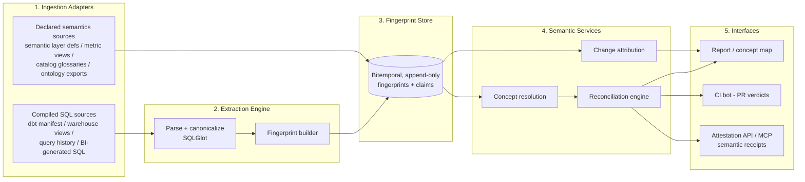

# Semantic Verification Engine — Technical Architecture Specification

**Companion to:** *Semantic Verification: A Ground-Truth Layer for Enterprise Ontologies*
**Status:** Draft v0.1 — architecture for review prior to build
**Design stance:** system-agnostic core with thin platform adapters; the fingerprint history store is the primary asset and is designed first.

---

## 1. Architecture overview

The system is organized as five layers around one central primitive: an append-only, bitemporal **Semantic Fingerprint Store**. Everything else — reconciliation, attribution, attestation — is a read model over that store. This ordering is deliberate: a scanner without the temporal store is a demo; the store is the moat.



Two invariants govern the design. First, **the store is append-only**: definitions are never updated in place, only superseded, because change attribution and restatement detection depend on complete history. Second, **verdicts must carry executable evidence**: every contradiction is backed either by a canonical-form diff or a numeric divergence measured against real data. No verdict ships on heuristics alone.

---

## 2. Layer 1 — Ingestion adapters

Adapters normalize heterogeneous inputs into two artifact types. A **ComputedArtifact** is anything containing executable definition logic: compiled dbt model SQL (from `manifest.json` + `target/compiled`), warehouse view and materialized-view definitions, high-frequency queries harvested from warehouse query history, and SQL emitted by BI tools. A **DeclaredArtifact** is anything containing a claimed definition: semantic-layer metric definitions (MetricFlow, LookML, metric views), catalog and glossary entries, and exports from inferred ontology products. Adapters are deliberately thin — parse the source format, attach provenance (system, object id, author if known, observed-at timestamp), and hand raw SQL or declared expressions to the extraction engine. Query history adapters additionally capture **usage telemetry** (execution counts, distinct users, downstream dashboards), which later drives severity ranking.

The v0 adapter set is one stack deep: dbt (manifest + compiled SQL), one warehouse's `information_schema` + query history, and one declared-semantics source. Everything else is a Phase 2 adapter, not an architecture change.

## 3. Layer 2 — Extraction engine

This is the technically hardest layer and the one your prior compiled-lineage work de-risks. The pipeline per artifact:

1. **Parse** to AST with SQLGlot, dialect-aware.
2. **Canonicalize**: qualify all identifiers against the catalog, expand `SELECT *`, inline or hoist CTEs, resolve aliases to physical columns, and normalize predicates (constant folding, commutative ordering of AND/OR and of comparison operands, De Morgan normalization). Relation identity is what the SQL wrote plus operator-supplied execution context (default database and schema); it is never inferred from a shared short catalog entry. Arithmetic is normalized only by swapping the two operands of a single `+` or `*`; it is never regrouped, because floating-point addition is not associative and integer overflow depends on evaluation order. Only genuinely semantics-neutral constructs are stripped: an ORDER BY that nothing bounds and no order-sensitive consumer reads. `LIMIT` and `OFFSET` change which rows a measure covers, so they are kept in the core together with the ordering that decides which rows survive.
3. **Fingerprint**: emit one fingerprint per measure expression discovered, with this schema:

```
Fingerprint {
  fingerprint_id      -- content hash of canonical form
  concept_candidate   -- best-effort name (column alias, metric name)
  measure_expr        -- canonical expression tree (e.g. SUM(amount) FILTER ...)
  grain               -- grouping keys at definition site
  filters[]           -- canonical predicate list
  join_graph          -- tables + join conditions reachable by the expression
  source_columns[]    -- fully qualified physical lineage terminals
  dialect, provenance, observed_at
}
```

Canonicalization will not achieve perfect semantic equivalence — SQL equivalence is undecidable in general. The design accepts this: canonical-form equality is treated as *proof of sameness* only within a stated scope (constructs the core models, relation identity resolved from explicit names or supplied context, a qualified parser version), and anything outside that scope blocks the conclusion rather than defaulting to sameness. Canonical-form difference is treated only as a *hypothesis of difference*, to be settled dynamically (§5). The equality claim is itself tested by execution: the oracle runs every pair the engine would certify as equal against adversarial data and requires exact agreement. This asymmetry is what keeps precision high, and the external reviews of October 2026 showed it holds only as well as it is tested.

## 4. Layer 3 — Fingerprint store (the core primitive)

A bitemporal, append-only store with two time axes per record: **valid time** (when this definition was the live logic in the estate, derived from git history, object DDL timestamps, or first/last observation) and **record time** (when the engine observed it). This enables the two compounding capabilities from the one-pager: *as-of queries* ("what did net revenue mean on 2026-03-01") and *restatement detection* (a comparison window that spans a valid-time boundary for its concept).

Storage: Postgres for v0 (fingerprints are small, relational, and the graph queries are shallow); Delta/Iceberg tables as the Phase 2 target when history volume and warehouse-native deployment matter. Entities: `Artifact`, `Fingerprint`, `Claim` (a declared definition, same canonical treatment where expressible), `Concept`, `Verdict`, `Receipt`. All verdict and receipt records reference immutable fingerprint ids, so any attestation ever issued can be replayed and audited.

## 5. Layer 4 — Semantic services

**Concept resolution.** Cluster fingerprints and claims into business concepts using three signals in priority order: lineage-terminal overlap (strongest — two expressions over the same physical columns are probably the same concept), canonical-expression similarity, and name similarity via embeddings. An LLM proposes concept labels and merge candidates; merges above a confidence threshold auto-apply, the rest queue for human confirmation. Human merge/split decisions are stored as durable overrides — the system must never re-litigate a settled identity.

**Reconciliation engine.** For each concept, compare all member fingerprints and claims and emit verdicts: `CERTIFIED` (declared and computed forms provably equivalent), `CONTRADICTION` (same concept, divergent logic), `ALIASING` (equivalent logic under different names), `ORPHAN_CLAIM` (declared, never computed), `SHADOW_METRIC` (computed, never declared). Equivalence resolution is two-stage. *Static*: canonical-form equality or known rewrite-rule equivalence. *Dynamic*, for unresolved pairs: an execution harness runs both definitions over an identical sample window (bounded scan, read-only, least-privilege service principal) and compares results per grain bucket with configurable tolerance. Numeric divergence is attached to the verdict as evidence — "definitions diverge by 3.2% over Q1" — and the divergence series is retained.

Every verdict gets a **severity score** = f(usage telemetry of the affected fingerprints, magnitude of numeric divergence, presence in declared/certified surfaces). This is the noise-control mechanism: the first scan of a real estate will find hundreds of raw contradictions, and the product lives or dies on surfacing the ten that matter.

**Change attribution.** Given a metric movement over [t0, t1]: replay definition-as-of-t0 and definition-as-of-t1 over both period datasets (where data time travel permits) and decompose the delta into definition effect, data effect, and interaction term — a two-way attribution directly analogous to price/volume variance decomposition. Where data time travel is unavailable, degrade gracefully to definition-change flagging without quantification.

## 6. Layer 5 — Interfaces

**Report / concept map**: per-concept dossier — canonical definition(s), verdicts with evidence, severity ranking, valid-time history ribbon. **CI bot**: on a PR touching transformation or semantic-layer code, extract fingerprints from the diff, reconcile against the store, and comment with any *newly introduced* verdicts — the wedge into daily workflow, and deliberately scoped to new problems only so it is never the messenger for pre-existing debt. **Attestation API / MCP server**: `attest(concept, as_of) → Receipt {definition_version, status, lineage, known_divergences, issued_at}`, callable by agents in the answer path. The MCP surface is Phase 2 but the receipt schema is frozen in Phase 1 so history is attestation-ready from day one.

## 7. Build phasing

**Phase 0 — proof (2–3 weekends).** dbt adapter + extraction + canonicalization + naive name-based clustering + static reconciliation + a static HTML report. Exit criterion: run against a real estate and find one contradiction that makes a stakeholder wince.

**Phase 1 — MVP (the Summit demo).** Fingerprint store with bitemporality, warehouse query-history adapter, dynamic execution harness, severity scoring, concept-resolution overrides, CI bot. Exit criterion: the restatement-detection demo — "this YoY comparison silently spans a definition change" — runs live.

**Phase 2 — product bets.** Attestation MCP server, change-attribution service, second-platform adapters, write-back certification into catalogs.

## 8. Key design decisions and tradeoffs

**Store-first, scanner-second** — accepted cost: Phase 0 is slightly slower than a throwaway script; benefit: history accrues from the first run. **Asymmetric equivalence** (static proves sameness, execution proves difference) — accepted cost: compute spend on the harness; benefit: verdict precision, which is the product's survival condition. **Thin adapters, fat core** — accepted cost: lowest-common-denominator ingestion; benefit: the cross-platform seam stays open. **Human-in-the-loop concept identity** — accepted cost: onboarding friction; benefit: clustering errors don't silently corrupt verdicts. **Postgres before Delta** — accepted cost: a later migration; benefit: weeks-faster Phase 0/1.

## 9. Open risks to validate during build

Canonicalization coverage across real-world SQL dialect abuse (measure: % of estate fingerprinted without manual intervention; target >85% in Phase 0). First-scan noise (measure: can severity ranking produce a top-10 list a stakeholder agrees is real). Execution-harness permissions in locked-down estates (mitigation: verdicts degrade to "unresolved — static difference" rather than blocking). Concept clustering precision on organically messy naming (measure: human override rate; if >30% of clusters need correction, the resolution signals need rework before Phase 1).
